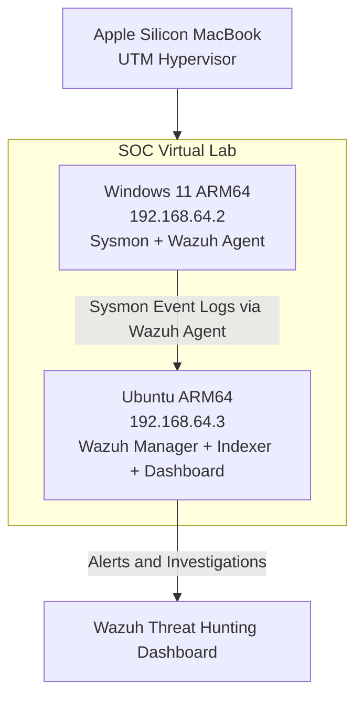

# SOC SIEM Home Lab — Wazuh & Sysmon

## Project Overview

A hands-on Security Operations Center (SOC) home lab designed to simulate enterprise endpoint monitoring, security event detection, threat hunting, and incident investigation.

Built using **Wazuh SIEM, Windows 11, Sysmon, and Ubuntu Server**, this project demonstrates practical cybersecurity skills relevant to entry-level SOC Analyst and Security Analyst roles.

**Project Status:** In Progress

## Lab Architecture

### Architecture Diagram

| Component | Technology | Purpose |
|---|---|---|
| Host Machine | Apple Silicon macOS | Virtualization host |
| Hypervisor | UTM | Virtual machine management |
| SIEM Server | Ubuntu Linux (ARM64) | Hosts Wazuh services |
| SIEM Platform | Wazuh 4.14.9 | Security monitoring, detection and investigation |
| Monitored Endpoint | Windows 11 ARM64 | Simulated enterprise workstation |
| Endpoint Telemetry | Microsoft Sysmon | Detailed Windows process event collection |
| Security Agent | Wazuh Agent | Forwards endpoint events to Wazuh |

### Detection Pipeline

Windows 11 → Sysmon → Wazuh Agent → Wazuh Manager → Wazuh Indexer → Wazuh Dashboard

Sysmon records endpoint activity, including process creation events. The Wazuh agent collects these events and forwards them to the manager, where detection rules evaluate activity and generate alerts. Indexed alerts can then be investigated through the Wazuh dashboard.

## Completed Lab Scenarios

### Lab 1 — SIEM Deployment and Endpoint Monitoring

- Deployed a Wazuh SIEM environment on an Ubuntu virtual machine.
- Configured a Windows 11 endpoint with the Wazuh agent.
- Installed Sysmon to collect process creation events (Event ID 1).
- Integrated Sysmon event collection with Wazuh.
- Verified endpoint connectivity and successful security event ingestion.
- Troubleshot clock synchronization and alert visibility issues.

**Skills:** SIEM deployment, Linux administration, endpoint monitoring, troubleshooting.

### Lab 2 — Custom Detection: User Discovery

**MITRE ATT&CK:** T1033 — System Owner/User Discovery

**Test command:** `whoami /all`

**Custom Wazuh Rule:** `100100`

- Created and tested a custom Wazuh detection rule for `whoami.exe` execution.
- Verified alerts in the Wazuh dashboard.
- Investigated the command line, executing user, parent process, and process integrity level.
- Correlated Sysmon Process IDs and Process GUIDs.
- Reconstructed the process chain from Windows Terminal through PowerShell to `whoami.exe`.

**Investigation Verdict:** True Positive — Benign (authorized lab simulation).

**Skills:** Detection engineering, XML rule configuration, process correlation, alert triage, MITRE ATT&CK mapping.

### Lab 3 — Local Account Enumeration Detection

**MITRE ATT&CK:** T1087.001 — Account Discovery: Local Account

**Test command:** `net user`

**Wazuh Rule:** `92031` (built-in)

- Simulated local account enumeration on the Windows endpoint.
- Confirmed Wazuh generated a discovery alert.
- Investigated `net.exe` launching `net1.exe`.
- Examined the command line, parent executable, and executing user.
- Classified the activity based on the authorized lab context.

**Investigation Verdict:** True Positive — Benign (authorized lab simulation).

**Skills:** Account discovery analysis, endpoint telemetry investigation, alert classification.

## Investigation Reports & Evidence

| Investigation | Detection | Evidence | Report |
|---|---|---|---|
| Lab 2 — User Discovery | Custom Wazuh Rule 100100 | [Alert Screenshot](lab2-whoami-alert.png) | [Investigation 01](investigations/01-whoami-discovery.md) |
| Lab 3 — Account Enumeration | Built-in Wazuh Rule 92031 | [Alert Screenshot](lab3-account-enumeration-alert.png) | [Investigation 02](investigations/02-account-enumeration.md) |

### Custom Detection Rules

- [Whoami Execution Detection — Rule 100100](detection-rules/whoami-detection.xml)

## Security Skills Demonstrated

- SIEM deployment and configuration
- Windows endpoint monitoring
- Sysmon event analysis
- Custom detection rule development
- Security alert triage
- Process tree reconstruction
- Threat hunting and log correlation
- MITRE ATT&CK technique mapping
- Linux administration and troubleshooting
- Incident investigation and documentation

## Planned Enhancements

- Privileged account enumeration detection
- Failed-login and brute-force investigation
- Suspicious PowerShell execution detection
- Persistence monitoring using scheduled tasks
- Multi-stage attack simulation and incident reporting

## Project Scope

All security simulations are performed within an isolated, personally controlled virtual lab for authorized educational purposes.

This repository will contain sanitized detection rules, investigation reports, architecture documentation, and screenshots demonstrating completed lab activities.
