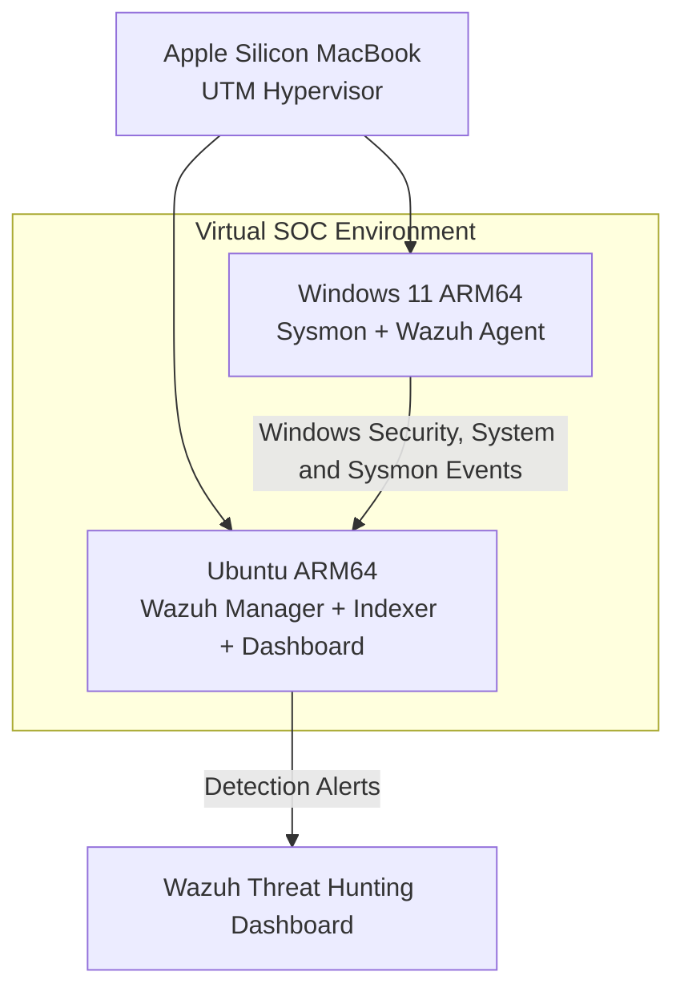

# SOC SIEM Home Lab — Wazuh & Sysmon

**Windows Endpoint Monitoring | Threat Detection | SOC Investigations | Detection Engineering**

## Project Overview

Designed and deployed a Security Operations Center (SOC) home lab to simulate Windows endpoint attacks, collect security telemetry, investigate alerts, and develop custom detection rules.

Built using **Wazuh SIEM, Microsoft Sysmon, Windows 11, Ubuntu Linux, and UTM virtualization**, this project demonstrates hands-on skills relevant to SOC Analyst, Security Analyst, and entry-level Detection Engineering roles.

The project covers the complete security monitoring workflow:

**Endpoint Activity → Log Collection → Detection → Alert Investigation → MITRE ATT&CK Mapping → Incident Documentation**

**Project Status:** Hands-on Labs 1–10 Completed | Portfolio Documentation Finalization

## Lab Architecture

### Architecture Diagram



| Component | Technology | Purpose |
|---|---|---|
| Host | Apple Silicon macOS | Virtualization platform |
| Hypervisor | UTM | Virtual machine management |
| SIEM Server | Ubuntu Linux ARM64 | Centralized security monitoring |
| SIEM | Wazuh 4.14.9 | Log analysis, alerting and investigations |
| Endpoint | Windows 11 ARM64 | Simulated enterprise workstation |
| Endpoint Telemetry | Microsoft Sysmon | Process creation and endpoint activity |
| Agent | Wazuh Agent | Windows event collection and forwarding |

### Detection Pipeline

```text
Windows Endpoint
      |
      v
Windows Event Logs + Sysmon
      |
      v
Wazuh Agent
      |
      v
Wazuh Manager
      |
      v
Detection Rules
      |
      v
Wazuh Indexer + Dashboard
      |
      v
SOC Investigation
```

## Completed Security Labs

| Lab | Scenario | Detection | MITRE ATT&CK |
|---|---|---|---|
| 1 | SIEM Deployment and Endpoint Integration | Agent and telemetry verification | — |
| 2 | User Discovery (`whoami`) | Custom Rule 100100 | T1033 |
| 3 | Local Account Enumeration | Built-in Wazuh detection | T1087.001 |
| 4 | Privileged Group Discovery | Built-in Wazuh detection | T1069.001 |
| 5 | Encoded PowerShell Execution | Built-in Rule 92057 | T1059.001 |
| 6 | Failed Authentication Investigation | Built-in Rule 60122; brute-force correlation gap documented | — |
| 7 | Renamed Executable Execution | Custom Rule 100101 | — |
| 8 | PowerShell Web Request | Custom Rule 100102 | T1105 |
| 9 | Scheduled Task Creation | Custom Rule 100103 | T1053.005 |
| 10 | Windows Service Installation | Custom Rule 100104 | T1543.003 |

*MITRE mappings identify techniques relevant to the simulated activity; they do not establish malicious intent.*

## Key Technical Investigations

### Lab 2 — User Discovery

Executed `whoami /all` to simulate system user discovery.

Developed custom Wazuh Rule `100100` and investigated process creation telemetry, command-line arguments, parent processes, executing accounts, and process identifiers.

**Result:** Successful custom detection.

### Labs 3–4 — Account and Privilege Discovery

Simulated local user enumeration and privileged group discovery using Windows command-line utilities.

Analyzed Wazuh alerts and process execution details to identify discovery activity.

**Result:** Existing Wazuh detections successfully identified the simulated activity.

### Lab 5 — Encoded PowerShell Execution

Simulated encoded PowerShell execution and investigated the resulting security alert.

**Detection:** Built-in Wazuh Rule `92057`, Level 12.

**Result:** Suspicious PowerShell command execution successfully detected.

### Lab 6 — Failed Authentication Investigation

Generated unsuccessful Windows authentication attempts using a nonexistent test account.

Analyzed Windows Event ID `4625` and Wazuh Rule `60122`.

**Result:** Individual failed authentication events were detected. A brute-force correlation alert was not observed during the test, and this detection limitation was documented.

### Lab 7 — Renamed Executable Detection

Copied the legitimate Windows `whoami.exe` executable to a test filename and executed it.

Examined Sysmon process creation telemetry, including executable paths and original filename metadata.

Developed custom Wazuh Rule `100101` to detect the specific test executable.

**Result:** Successful Level 8 alert.

**Detection limitation:** The custom rule matches the test filename rather than generically detecting all executable masquerading.

### Lab 8 — PowerShell Web Request Detection

Executed a benign PowerShell `Invoke-WebRequest` command against `https://example.com/`.

Observed that the existing Wazuh alert identified PowerShell process spawning but did not specifically classify the web request.

Developed custom Rule `100102` to detect the `Invoke-WebRequest` command-line pattern.

**Result:** Successful Level 8 alert.

**Detection limitation:** Process creation telemetry confirms command execution, not necessarily successful file download.

### Lab 9 — Scheduled Task Persistence

Created a harmless scheduled task configured to launch Notepad at user logon.

Enabled and investigated Windows Security Event ID `4698`.

Identified built-in Wazuh Rule `60228`, then developed custom Rule `100103` for the named test task.

**Result:** Successful Level 8 alert. Test task removed after validation.

### Lab 10 — Windows Service Installation

Registered a harmless Windows service configured with a manual startup type.

Investigated:

- Security Event ID `4697`
- System Event ID `7045`
- Built-in Wazuh Rule `61138`

Developed custom Rule `100104` to detect the test service display name.

**Result:** Successful Level 8 alert. Test service removed after validation.

## Investigation Reports and Evidence

| Investigation | Detection Evidence | Investigation Report |
|---|---|---|
| Lab 2 — User Discovery | [Screenshot](lab2-whoami-alert.png) | [Report](investigations/01-whoami-discovery.md) |
| Lab 3 — Account Enumeration | [Screenshot](lab3-account-enumeration-alert.png) | [Report](investigations/02-account-enumeration.md) |
| Lab 4 — Privileged Group Discovery | [Screenshot](lab4-privileged-group-alert.png) | [Report](investigations/03-privileged-group-discovery.md) |
| Lab 5 — Encoded PowerShell | [Screenshot](lab5-encoded-powershell-alert.png) | [Report](investigations/04-encoded-powershell.md) |
| Lab 6 — Failed Authentication | [Screenshot](lab6-failed-login-alert.png) | [Report](investigations/05-failed-authentication.md) |
| Lab 7 — Renamed Executable | [Screenshot](lab7-renamed-executable-alert.png) | [Report](investigations/06-renamed-executable.md) |
| Lab 8 — PowerShell Web Request | [Screenshot](lab8-powershell-download-alert.png) | [Report](investigations/07-powershell-web-download.md) |
| Lab 9 — Scheduled Task Creation | [Screenshot](lab9-scheduled-task-alert.png) | [Report](investigations/08-scheduled-task-creation.md) |
| Lab 10 — Windows Service Installation | [Screenshot](lab10-windows-service-installation-alert.png) | [Report](investigations/09-windows-service-installation.md) |

## Custom Detection Engineering

Developed and validated five custom Wazuh rules:

| Rule ID | Detection Logic | Severity |
|---|---|---|
| 100100 | `whoami.exe` execution | Level 5 |
| 100101 | Specific renamed executable test filename | Level 8 |
| 100102 | PowerShell `Invoke-WebRequest` command line | Level 8 |
| 100103 | Specific scheduled task creation | Level 8 |
| 100104 | Specific Windows service installation | Level 8 |

Rules were configured using Wazuh XML rule definitions, validated using `wazuh-analysisd -t`, and tested against endpoint activity.

These rules are educational proof-of-concept detections. Several intentionally match lab-specific names and would require generalization, tuning, and false-positive testing before production deployment.

## Security Skills Demonstrated

**SOC Operations**
- Security alert triage and classification
- Windows event log analysis
- SIEM threat hunting
- Incident investigation and reporting
- Evidence collection and documentation

**Detection Engineering**
- Custom Wazuh XML rule development
- Windows Security and System event monitoring
- Sysmon process telemetry analysis
- MITRE ATT&CK mapping
- Detection validation and troubleshooting
- Identification of detection gaps

**Infrastructure and Tools**
- Wazuh SIEM
- Microsoft Sysmon
- Windows 11
- Ubuntu Linux
- UTM virtualization
- PowerShell and Bash
- `jq` log analysis
- GitHub documentation

## Key Lessons Learned

1. Successful endpoint telemetry collection does not automatically guarantee a useful security alert.
2. Built-in detection rules provide valuable baseline monitoring but may require customization.
3. Process command lines, parent-child relationships, and service configurations provide important investigation context.
4. Legitimate administrative activity can resemble attacker techniques.
5. Detection gaps and limitations should be documented rather than concealed.
6. Custom rules require validation against real events before they can be considered effective.
7. Authorized simulations should be cleaned up after testing.

## Future Enhancements

- Build generalized detections for suspicious service and scheduled-task activity.
- Implement multi-event correlation for repeated authentication failures.
- Integrate network monitoring using Suricata or Zeek.
- Develop a multi-stage attack simulation with a consolidated incident timeline.
- Automate detection testing and log analysis using Python.
- Create dashboards for monitoring detection coverage and alert trends.

## Project Scope

All simulations were performed within a personally controlled virtual lab for authorized cybersecurity education.

The project does not involve unauthorized access, external targets, or real-world malicious payload deployment.

**Purpose:** Demonstrate practical SOC analysis, endpoint monitoring, detection engineering, and incident investigation capabilities.
