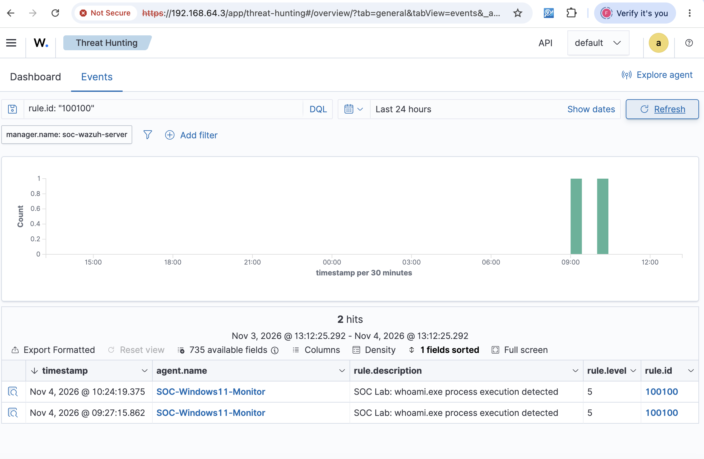

# SOC Investigation 01 — User Discovery Detection

**Case ID:** SOC-LAB-001  
**Date:** November 4, 2026  
**Platform:** Wazuh SIEM + Windows Sysmon  
**Endpoint:** SOC-Windows11-Monitor  
**Classification:** True Positive — Benign (Authorized Lab Activity)  
**Status:** Closed

## 1. Executive Summary

A custom Wazuh detection rule identified the execution of `whoami.exe` on a monitored Windows 11 endpoint.

The command was executed intentionally as part of an authorized SOC lab simulation. The investigation confirmed the executing user, command-line arguments, parent process, process identifiers, and process ancestry.

No malicious activity was identified within the scope of the investigated event.

## 2. Alert Details

| Field | Value |
|---|---|
| Detection Rule | 100100 |
| Alert Description | SOC Lab: whoami.exe process execution detected |
| Severity | Level 5 |
| MITRE ATT&CK | T1033 — System Owner/User Discovery |
| Data Source | Sysmon Event ID 1 — Process Creation |
| Executable | `C:\Windows\System32\whoami.exe` |
| Command | `whoami /all` |
| User | `WIN-1II1QICSGLT\Dhiraj` |
| Integrity Level | High |
| Process ID | 2956 |
| Parent Process ID | 5136 |

Two matching alerts were observed in the Wazuh Threat Hunting dashboard.

## 3. Investigation Methodology

The following investigation steps were performed:

1. Filtered Wazuh Threat Hunting events using rule ID `100100`.
2. Verified the detection timestamp, endpoint, severity, and rule description.
3. Examined the Sysmon command-line and user fields.
4. Identified PowerShell as the parent process.
5. Correlated Process IDs and Sysmon Process GUIDs.
6. Queried Windows Sysmon Event ID 1 logs to reconstruct the process tree.
7. Evaluated the activity against the known authorized test.

## 4. Process Tree Analysis

```text
svchost.exe
└── WindowsTerminal.exe
    ├── powershell.exe
    │   └── whoami.exe /all
    └── OpenConsole.exe
```

The Sysmon evidence showed that Windows Terminal launched PowerShell, which subsequently executed `whoami.exe`.

The execution occurred under the monitored user's account with a high-integrity security token.

The observed process chain was consistent with the authorized administrative PowerShell session used during the lab.

## 5. Detection Logic

The custom Wazuh rule used:

- Rule ID: `100100`
- Base Sysmon rule: `61603`
- Executable field: `win.eventdata.image`
- Matching expression: `(?i)whoami\.exe$`
- MITRE ATT&CK: `T1033`

**Detection rule:** [whoami-detection.xml](../detection-rules/whoami-detection.xml)

The rule detects execution of `whoami.exe`. It does not independently determine whether that execution is malicious.

## 6. Evidence

**Wazuh alert screenshot:**



The screenshot demonstrates that two events matched custom rule `100100` on the monitored Windows endpoint.

## 7. Analyst Assessment

**Verdict: True Positive — Benign**

The alert was a true positive because the configured rule correctly detected the targeted executable.

The activity was classified as benign because the command was deliberately executed as part of an authorized lab test.

In a production environment, similar activity would require additional context, including account behavior, process ancestry, authentication history, and surrounding endpoint events.

## 8. Lessons Learned

- Sysmon Event ID 1 provides valuable process execution telemetry.
- Wazuh custom rules can detect specific executable activity.
- Parent-child process relationships help reconstruct execution context.
- Process GUIDs provide more reliable event correlation than PIDs alone.
- A correctly triggered security alert does not necessarily indicate malicious activity.
- Time synchronization is important for accurate SIEM investigation and event correlation.

## 9. Final Disposition

**Case closed — Authorized security simulation.**

No containment or remediation was required because the observed activity was expected and performed within the controlled lab environment.
