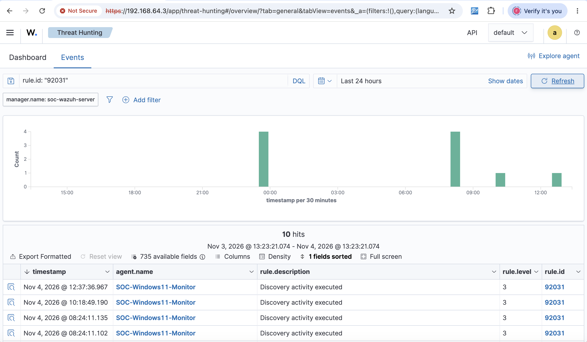

# SOC Investigation 02 — Local Account Enumeration

**Case ID:** SOC-LAB-002  
**Date:** November 4, 2026  
**Platform:** Wazuh SIEM + Windows Sysmon  
**Endpoint:** SOC-Windows11-Monitor  
**Classification:** True Positive — Benign (Authorized Lab Activity)  
**Status:** Closed

## 1. Executive Summary

Wazuh detected account discovery activity on a monitored Windows 11 endpoint through its built-in detection rule `92031`.

The investigation identified `net1.exe` executing with the argument `user`, launched by its parent process `net.exe`.

The activity was associated with the authorized `net user` command executed during the SOC lab.

The alert was classified as a true positive because the discovery activity occurred as detected, but the activity was benign within the context of the authorized simulation.

## 2. Alert Details

| Field | Value |
|---|---|
| Wazuh Rule ID | 92031 |
| Alert Description | Discovery activity executed |
| Severity | Level 3 |
| MITRE ATT&CK | T1087.001 — Account Discovery: Local Account |
| Endpoint | SOC-Windows11-Monitor |
| Executable | `C:\Windows\System32\net1.exe` |
| Command Line | `C:\WINDOWS\system32\net1 user` |
| Parent Executable | `C:\Windows\System32\net.exe` |
| Executing User | `WIN-1II1QICSGLT\Dhiraj` |

The Wazuh dashboard showed 10 matching discovery alerts within the selected 24-hour window. The investigation focused on the event whose executable and command-line fields matched the authorized account enumeration test.

## 3. Investigation Methodology

1. Opened Wazuh Threat Hunting and filtered events by rule ID `92031`.
2. Reviewed the matching alert timestamps, endpoint names, and severity levels.
3. Selected the relevant Windows endpoint alert.
4. Examined the executable and command-line fields.
5. Identified `net.exe` as the parent of `net1.exe`.
6. Verified the user account associated with the process.
7. Compared the observed behavior with the authorized `net user` simulation.
8. Classified the event based on the available evidence.

## 4. Process Analysis

```text
net.exe
└── net1.exe user
```

The process relationship demonstrates how Windows account enumeration activity can be observed through endpoint process telemetry.

The `net user` command lists local user accounts when executed without a domain option.

The observed execution was consistent with the authorized command used during the lab.

## 5. MITRE ATT&CK Mapping

**Technique:** T1087.001 — Account Discovery: Local Account

Account discovery is a technique that adversaries may use to identify available accounts on a compromised system.

The presence of this technique alone does not establish malicious intent. Administrators and legitimate system utilities can perform similar actions.

## 6. Evidence

**Wazuh discovery alert screenshot:**



The screenshot shows the Wazuh Threat Hunting results for rule `92031`, including the monitored endpoint, alert description, and severity.

The event details were separately examined to confirm the `net1.exe` command line, `net.exe` parent process, and executing user.

## 7. Analyst Assessment

**Verdict: True Positive — Benign**

The alert correctly identified account discovery activity.

The execution was expected because it was performed intentionally during the authorized SOC simulation.

In a production environment, further investigation would consider:

- Whether the user account normally performs administrative discovery.
- Whether the command was executed during an expected maintenance activity.
- Whether additional discovery or privilege escalation activity occurred nearby.
- Whether the parent process or execution context was unusual.
- Whether the endpoint showed signs of compromise.

## 8. Lessons Learned

- Wazuh's built-in rules can detect account discovery activity.
- Windows utilities may create child processes that are relevant to investigations.
- Examining executable paths and command-line arguments helps identify the actual behavior.
- Parent-child process relationships provide important context.
- Multiple alerts matching the same rule may represent different underlying activities.
- SOC analysts must distinguish accurate detections from genuinely malicious behavior.

## 9. Final Disposition

**Case closed — Authorized account enumeration simulation.**

No containment or remediation was required for the investigated event.
