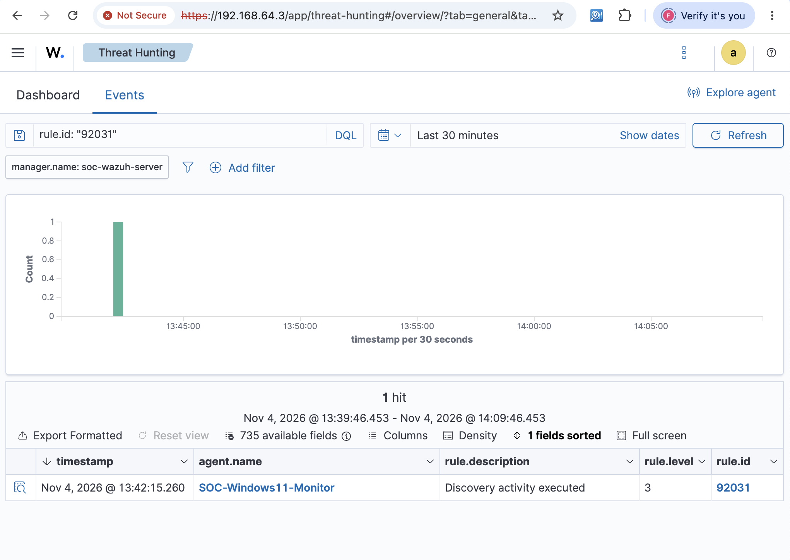

# SOC Investigation 03 — Privileged Group Discovery

**Case ID:** SOC-LAB-003  
**Date:** November 4, 2026  
**Platform:** Wazuh SIEM + Windows Sysmon  
**Endpoint:** SOC-Windows11-Monitor  
**Classification:** True Positive — Benign (Authorized Lab Activity)  
**Status:** Closed

## 1. Executive Summary

Wazuh detected local privileged-group enumeration on a monitored Windows 11 endpoint.

The investigation identified `net1.exe` executing the command `net1 localgroup administrators`, initiated through its parent process `net.exe`.

The activity was deliberately performed as part of an authorized cybersecurity laboratory exercise.

## 2. Alert Information

| Field | Value |
|---|---|
| Detection Time | November 4, 2026, 13:42:15 |
| Wazuh Rule ID | 92031 |
| Rule Description | Discovery activity executed |
| Severity | Level 3 |
| Endpoint | SOC-Windows11-Monitor |
| MITRE ATT&CK | T1069.001 — Permission Groups Discovery: Local Groups |

## 3. Investigation Evidence

| Field | Observed Value |
|---|---|
| Process Image | `C:\Windows\System32\net1.exe` |
| Command Line | `net1 localgroup administrators` |
| Parent Image | `C:\Windows\System32\net.exe` |
| Executing User | `WIN-1II1QICSGLT\Dhiraj` |

### Wazuh Alert Screenshot

## 4. Process Analysis

Observed process relationship:

`net.exe` → `net1.exe`

The `net1 localgroup administrators` command enumerates the members of the local Administrators group.

The observed output included:

- Administrator
- Dhiraj

This information can help an attacker identify privileged accounts, but the command also has legitimate administrative uses.

## 5. MITRE ATT&CK Mapping

**Tactic:** Discovery  
**Technique:** T1069 — Permission Groups Discovery  
**Sub-technique:** T1069.001 — Local Groups

Attackers may enumerate local administrative groups to identify accounts with elevated privileges before attempting additional actions.

## 6. Detection Analysis

Wazuh's built-in rule `92031` generated a Level 3 discovery alert.

The investigation demonstrates how Sysmon process telemetry and Wazuh detection rules can help security analysts identify account and group enumeration.

A discovery alert alone does not establish malicious intent. Additional context, including the executing user, process lineage, command arguments, and authorized activity, is necessary.

## 7. Analyst Assessment

**Detection validity:** True Positive  
**Security disposition:** Benign — Authorized Simulation

The command execution was confirmed, and the detection matched the observed activity.

No evidence of unauthorized access, privilege escalation, or malicious follow-on activity was established by this investigation.

## 8. Response and Remediation

No containment or remediation was required.

The activity was intentionally generated within an isolated, controlled security laboratory.

## 9. Skills Demonstrated

- SIEM alert triage
- Windows process investigation
- Parent-child process analysis
- Privileged-group enumeration detection
- MITRE ATT&CK mapping
- True-positive versus malicious-activity classification
- Security investigation documentation

## 10. Final Disposition

**Case closed — Authorized security simulation.**

The investigation successfully demonstrated detection and analysis of local privileged-group discovery using Wazuh and Sysmon.
