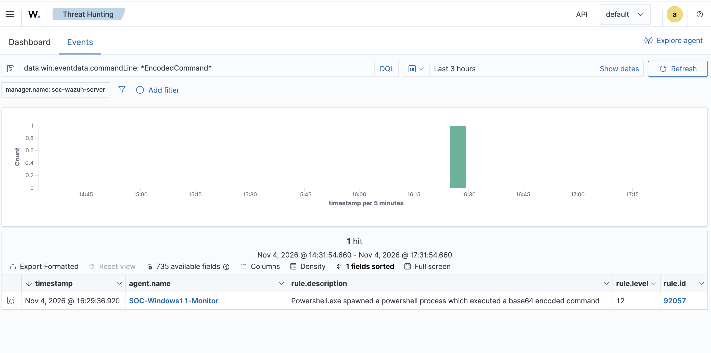

# SOC Investigation 04 — Encoded PowerShell Execution

**Case ID:** SOC-LAB-004  
**Date:** November 4, 2026  
**Platform:** Wazuh SIEM + Windows Sysmon  
**Endpoint:** SOC-Windows11-Monitor  
**Classification:** True Positive — Benign (Authorized Lab Activity)  
**Status:** Closed

## 1. Executive Summary

Wazuh detected PowerShell executing a Base64-encoded command on a monitored Windows 11 endpoint.

The activity triggered built-in Wazuh rule **92057**, generating a **Level 12** security alert.

The analyst investigated the command-line arguments, process execution context, and encoded payload. The decoded command was determined to be harmless and executed intentionally within an authorized SOC home lab.

No malicious activity was identified.

## 2. Alert Information

| Field | Value |
|---|---|
| Detection Rule | 92057 |
| Severity | Level 12 |
| Description | Powershell.exe spawned a powershell process which executed a base64 encoded command |
| Endpoint | SOC-Windows11-Monitor |
| Alert Timestamp | November 4, 2026, 16:29:36.920 (dashboard display) |
| Data Source | Windows Sysmon via Wazuh Agent |
| Activity | Encoded PowerShell execution |

## 3. Investigation Evidence

The analyst reviewed the process creation telemetry collected by Sysmon and forwarded to Wazuh.

**Observed executable:**

`C:\Windows\System32\WindowsPowerShell\v1.0\powershell.exe`

**Observed command-line arguments:**

```powershell
-NoProfile -EncodedCommand VwByAGkAdABlAC0ATwB1AHQAcAB1AHQAIAAnAFMATwBDACAATABhAGIAIAA1ACAARQBuAGMAbwBkAGUAZAAgAFQAZQBzAHQAJwA=
```

**Parent process:**

`C:\Windows\System32\WindowsPowerShell\v1.0\powershell.exe`

**User account:**

`WIN-1II1QICSGLT\Dhiraj`

## 4. Payload Decoding

PowerShell's `-EncodedCommand` argument accepts a Base64-encoded UTF-16LE command.

After decoding, the payload was:

```powershell
Write-Output 'SOC Lab 5 Encoded Test'
```

This command simply prints a test message to the console.

Base64 encoding is not encryption. Although encoded commands may be used to conceal malicious instructions, their presence alone does not establish malicious intent.

## 5. Process Analysis

The observed execution involved a PowerShell process launching another PowerShell process with the `-EncodedCommand` argument.

The process relationship was:

```text
powershell.exe
    |
    +-- powershell.exe
          |
          +-- -NoProfile -EncodedCommand
```

The command was executed by the expected lab user.

No evidence of credential theft, persistence, malicious downloads, or unauthorized system modification was identified in the reviewed command and alert telemetry.

## 6. MITRE ATT&CK Mapping

**Technique:** T1059.001 — Command and Scripting Interpreter: PowerShell

The activity demonstrates PowerShell command execution using an encoded payload.

This technique is associated with legitimate administrative activity as well as attacker tradecraft.

The technique mapping describes the observed behavior and does not independently establish that the execution was malicious.

## 7. Analyst Assessment

The detection was a **true positive** because the encoded PowerShell execution genuinely occurred and matched the detection logic.

However, the activity was **benign** because:

- The execution was intentionally performed within an authorized security lab.
- The decoded payload only printed a test message.
- The observed user and process context matched the expected simulation.
- The reviewed evidence did not establish malicious behavior.

The alert demonstrates why analysts must investigate execution context rather than rely exclusively on severity ratings.

## 8. Evidence



**Evidence file:** `lab5-encoded-powershell-alert.png`

**Detection source:** Wazuh built-in rule 92057.

## 9. Final Disposition

**Case closed — Authorized security simulation.**

No containment or remediation was required.

The investigation demonstrates practical SOC Analyst skills in alert triage, Windows process analysis, Base64 decoding, SIEM investigation, MITRE ATT&CK mapping, and incident documentation.
