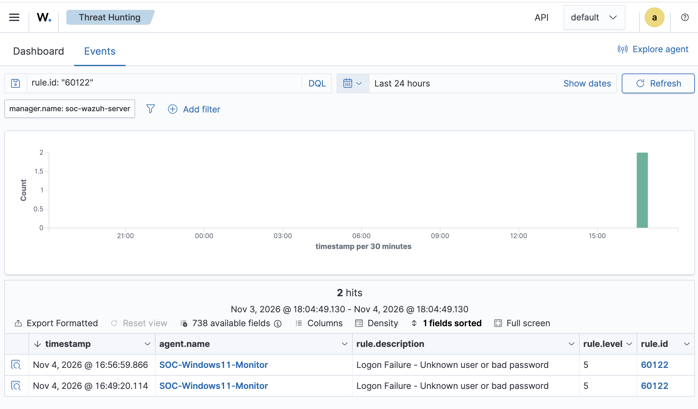

# SOC Investigation 05 — Failed Authentication and Detection Gap Analysis

**Case ID:** SOC-LAB-005  
**Date:** November 4, 2026  
**Platform:** Wazuh SIEM + Windows 11 Security Event Logs  
**Endpoint:** SOC-Windows11-Monitor  
**Classification:** True Positive — Benign (Authorized Lab Activity)  
**Status:** Closed

## 1. Executive Summary

A controlled authentication-failure simulation was performed against a Windows 11 virtual machine to evaluate Windows Security auditing and Wazuh SIEM detection capabilities.

Five unsuccessful authentication attempts were deliberately initiated using an invalid local username and password.

The investigation identified two matching Windows Security Event ID 4625 records and two Wazuh alerts associated with detection rule 60122.

No additional alert associated with the tested correlation rule 60110 was observed during the selected investigation window.

The activity was authorized and confined to the local lab environment.

## 2. Investigation Objectives

- Generate controlled failed authentication attempts.
- Verify Windows Security Event ID 4625 logging.
- Identify failed-login alerts in Wazuh.
- Examine the source address, authentication protocol, account name, and failure reason.
- Evaluate whether repeated failures generated an additional correlation alert.
- Document the differences between attempted authentication operations, recorded Windows events, and SIEM alerts.

## 3. Lab Environment

| Component | Description |
|---|---|
| SIEM | Wazuh |
| Operating system | Windows 11 ARM64 |
| Endpoint agent | Wazuh Agent |
| Virtualization | UTM |
| Windows event source | Security Event Log |
| Authentication protocol | NTLM |
| Test destination | 127.0.0.1 |

## 4. Simulation Procedure

The following command was executed from an authorized Windows PowerShell session:

```powershell
1..5 | ForEach-Object {
    net use \\127.0.0.1\IPC$ /user:.\FakeSOCUser WrongPassword123!
    Start-Sleep -Seconds 2
}
```

The command attempted to authenticate five times using an intentionally nonexistent local account.

Each attempt returned Windows system error 1326, indicating that the username or password was incorrect.

No valid credentials were used and no successful authentication was demonstrated.

## 5. Windows Event Investigation

The Windows Security log was examined using PowerShell to identify Event ID 4625 records involving `FakeSOCUser`.

Two matching events were observed:

| Time | Event ID | Description |
|---|---|---|
| 2:51:30 PM | 4625 | Failed authentication |
| 2:58:34 PM | 4625 | Failed authentication |

The latest event contained the following information:

| Field | Value |
|---|---|
| Account Name | FakeSOCUser |
| Logon Type | 3 |
| Source Network Address | 127.0.0.1 |
| Authentication Package | NTLM |
| Status | 0xC000006D |
| Sub Status | 0xC0000064 |
| Workstation | WIN-1II1QICSGLT |

### Interpretation

Logon Type 3 indicates network authentication.

The loopback address `127.0.0.1` confirms that the observed authentication attempt originated from the local Windows machine.

Status `0xC000006D` indicates an authentication failure, while substatus `0xC0000064` identifies an unknown username.

The evidence is consistent with the intentionally invalid account used during the simulation.

## 6. Wazuh SIEM Detection

Wazuh Threat Hunting identified two alerts matching rule 60122.

| Field | Result |
|---|---|
| Rule ID | 60122 |
| Description | Logon Failure - Unknown user or bad password |
| Severity | Level 5 |
| Agent | SOC-Windows11-Monitor |
| Observed alert count | 2 |

The alerts confirmed that Wazuh received and analyzed Windows authentication-failure telemetry.

### Detection Evidence



## 7. Repeated Authentication Failure Analysis

Five failed authentication operations were attempted during the controlled simulation.

However, only two matching Windows Security events and two Wazuh alerts were identified.

The investigation also searched for Wazuh rule 60110 but found no matching alerts within the selected time window.

This does not establish that all five attempts generated Windows Security events or that a brute-force attack occurred.

Further investigation would be required to determine why the number of attempted operations exceeded the number of observed Windows Security records.

Potential areas for additional validation include Windows event-generation behavior, audit configuration, event forwarding, and Wazuh correlation thresholds.

## 8. MITRE ATT&CK Mapping

**T1110 — Brute Force**

The scenario simulates repeated unsuccessful authentication attempts associated with brute-force behavior.

This mapping describes the technique being tested, not a confirmed malicious brute-force intrusion.

## 9. Analyst Assessment

**Detection:** Confirmed  
**Successful compromise:** Not observed  
**Malicious intent:** Not present in this authorized simulation  
**Repeated-failure correlation:** Not demonstrated  
**Detection coverage:** Partially validated

The SIEM successfully identified the two Windows authentication failures that were observed in the Security log.

The investigation highlights the importance of comparing endpoint evidence against SIEM alerts before drawing conclusions about detection coverage.

## 10. Final Disposition

**Case closed — Authorized security simulation.**

No containment or remediation was required.

The investigation demonstrated practical experience in Windows authentication auditing, Wazuh alert analysis, event correlation assessment, and documenting detection limitations.

Future testing should verify correlation thresholds and compare raw Windows Security events against SIEM ingestion to establish more complete detection coverage.
