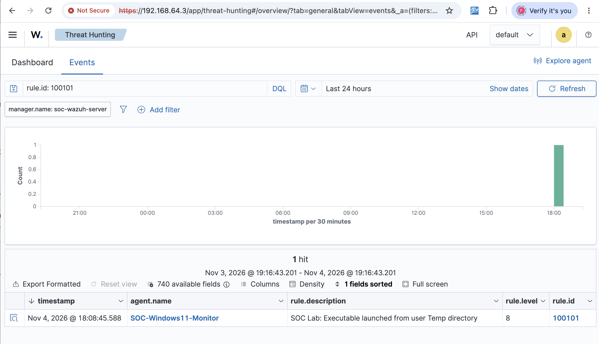

# SOC Investigation 06 — Renamed Executable Detection and Custom SIEM Rule Development

**Investigation ID:** SOC-INV-006  
**Date:** November 4, 2026  
**Environment:** SOC SIEM Home Lab  
**SIEM Platform:** Wazuh 4.14.9  
**Endpoint Monitoring:** Sysmon and Wazuh Agent  
**Alert Rule ID:** 100101  
**Alert Severity:** Level 8  
**MITRE ATT&CK:** T1036.003 — Masquerading: Rename System Utilities  
**Investigation Status:** Closed — Detection Validated  
**Classification:** True Positive — Benign (Authorized Security Testing)

---

## 1. Executive Summary

During a controlled security simulation, a legitimate Windows system utility (`whoami.exe`) was copied to a user's temporary directory and renamed `SOC-Lab7-Test.exe`.

The objective was to investigate whether the Security Information and Event Management (SIEM) platform could detect execution of a renamed Windows executable from a user-writable directory.

Sysmon successfully recorded the process execution using Event ID 1, and the Wazuh agent forwarded the event to the SIEM manager.

However, the initial execution did not generate a corresponding security alert, revealing a detection gap.

A custom Wazuh detection rule was subsequently developed, tested, and deployed.

Following rule refinement and validation, Wazuh successfully generated a **Level 8 security alert under Rule ID 100101**.

This investigation demonstrates endpoint telemetry analysis, SIEM troubleshooting, custom detection engineering, and alert validation.

## 2. Investigation Objectives

- Simulate execution of a renamed Windows system utility.
- Verify process creation telemetry using Sysmon.
- Confirm event ingestion into the Wazuh SIEM.
- Identify potential detection gaps.
- Develop and deploy a custom detection rule.
- Validate detection through controlled endpoint execution.
- Document investigation findings and supporting evidence.

## 3. Lab Environment

| Component | Configuration |
|---|---|
| SIEM | Wazuh 4.14.9 |
| SIEM Server | Ubuntu Linux VM |
| Monitored Endpoint | Windows 11 VM |
| Endpoint Agent | Wazuh Agent 4.14.9 |
| Endpoint Agent ID | 001 |
| Endpoint Hostname | SOC-Windows11-Monitor |
| Endpoint Telemetry | Microsoft Sysmon |
| Relevant Event | Sysmon Event ID 1 — Process Creation |
| Detection Rule | Custom Wazuh Rule 100101 |
| Virtualization | UTM |

All activities were performed within an isolated, authorized cybersecurity laboratory.

## 4. Initial Detection Scenario

### 4.1 Simulated Activity

A legitimate Windows executable was copied from the operating system directory into the current user's temporary directory under a different filename.

The following PowerShell commands were executed:

```powershell
Copy-Item "$env:WINDIR\System32\whoami.exe" "$env:TEMP\SOC-Lab7-Test.exe"

Get-FileHash "$env:TEMP\SOC-Lab7-Test.exe" -Algorithm SHA256

& "$env:TEMP\SOC-Lab7-Test.exe"
```

The renamed executable successfully executed and displayed the current Windows user account.

### 4.2 Security Relevance

Renaming a legitimate system utility can be associated with masquerading techniques, in which an adversary changes a file's name or location to obscure its identity or evade filename-based detections.

Execution from a user-writable temporary directory can also warrant additional investigation because such locations may be used to stage executable files.

However, these characteristics alone do not establish malicious intent.

In this investigation, the activity was intentionally generated for authorized detection testing.

## 5. Evidence Collection and Telemetry Analysis

### 5.1 Sysmon Process Creation Event

Windows Sysmon successfully recorded the renamed executable's execution.

**Relevant event attributes:**

| Field | Observed Value |
|---|---|
| Event Source | Microsoft-Windows-Sysmon |
| Event ID | 1 |
| Executable | SOC-Lab7-Test.exe |
| Original Filename | whoami.exe |
| Execution Directory | User AppData Local Temp |
| Parent Process | powershell.exe |
| User Context | Local Windows user |
| Integrity Level | High |
| SHA256 | 05F24553698D8F2383D2F2EAE3DD40029DBA609BF87B809E4E8D54763417CE4B |

The `OriginalFileName` metadata identified the executable as `whoami.exe`, despite the modified filename used during execution.

This distinction is useful during process masquerading investigations.

### 5.2 Wazuh Event Ingestion

The Wazuh manager's JSON archives were temporarily enabled for troubleshooting.

The following file was examined:

```bash
/var/ossec/logs/archives/archives.json
```

The archived events confirmed that:

- The Windows endpoint generated the expected Sysmon event.
- The Wazuh agent forwarded the event.
- The Wazuh manager received the telemetry.
- The event was processed using the `windows_eventchannel` decoder.
- The process image and original filename were available for detection analysis.

This established that the event collection pipeline was functioning.

### 5.3 Initial Alert Search

The Wazuh alert records were searched for the renamed executable.

No matching alert was found during the initial investigation.

**Initial finding:** The process execution was recorded and ingested, but the existing alerting configuration did not produce a corresponding detection.

This was classified as a detection coverage gap for the simulated activity.

## 6. Detection Engineering and Troubleshooting

### 6.1 Initial Custom Rule

A custom detection rule was added to:

```text
/var/ossec/etc/rules/local_rules.xml
```

The initial rule attempted to identify executable execution from a user's AppData Local Temp directory.

Although Wazuh accepted the XML configuration, the rule did not initially generate an alert.

### 6.2 Troubleshooting Methodology

The following checks were performed:

1. Validated the Wazuh rules configuration using `wazuh-analysisd -t`.
2. Confirmed that the Wazuh manager service was active.
3. Examined Sysmon Event ID 1 telemetry.
4. Verified event ingestion in the Wazuh JSON archives.
5. Inspected Wazuh's built-in Sysmon rules, including Rule 61603.
6. Verified the `windows_eventchannel` decoder.
7. Used `wazuh-logtest` to inspect event decoding.
8. Examined the process image field and its escaped Windows path formatting.
9. Simplified the custom detection condition to match the laboratory executable's filename.
10. Restarted the Wazuh manager and repeated the execution test.

The investigation established that successful event ingestion does not automatically guarantee that a corresponding security alert will be generated.

### 6.3 Final Validated Custom Rule

The following simplified rule successfully detected the laboratory executable:

```xml
<rule id="100101" level="8">
  <if_sid>61603</if_sid>
  <field name="win.eventdata.image" type="pcre2">(?i)SOC-Lab7-Test\.exe$</field>
  <description>SOC Lab: Executable launched from user Temp directory</description>
  <mitre>
    <id>T1204.002</id>
  </mitre>
  <group>soc_lab,suspicious_execution,</group>
</rule>
```

**Rule explanation:**

- `id="100101"`: Unique identifier for the custom detection.
- `level="8"`: Assigns Level 8 alert severity.
- `<if_sid>61603</if_sid>`: Uses the built-in Sysmon process creation rule as its parent.
- `win.eventdata.image`: Examines the executable path recorded by Sysmon.
- `(?i)`: Enables case-insensitive matching.
- `SOC-Lab7-Test\.exe$`: Matches the specific test executable filename.
- `T1204.002`: MITRE ATT&CK mapping configured in the rule.

**Detection scope limitation:** The final rule matches the specific laboratory filename. It does not generically detect every renamed system utility or every executable launched from a Temp directory.

The rule description and ATT&CK mapping should be refined in future iterations to align precisely with the implemented detection logic.

## 7. Detection Validation

After updating the custom rule, the Wazuh configuration was validated:

```bash
sudo /var/ossec/bin/wazuh-analysisd -t
```

The Wazuh manager was restarted:

```bash
sudo systemctl restart wazuh-manager
```

The service status was verified:

```bash
sudo systemctl is-active wazuh-manager
```

**Result:** `active`

The renamed executable was then executed again from the Windows endpoint:

```powershell
& "$env:TEMP\SOC-Lab7-Test.exe"
```

### 7.1 Successful Alert Generation

The Wazuh SIEM successfully generated the following alert:

| Attribute | Result |
|---|---|
| Rule ID | 100101 |
| Alert Level | 8 |
| Agent | SOC-Windows11-Monitor |
| Triggering Executable | SOC-Lab7-Test.exe |
| Alert Description | SOC Lab: Executable launched from user Temp directory |
| Dashboard Timestamp | November 4, 2026, 18:08:45.588 |
| Detection Outcome | Successful |

The alert was independently verified through both the Wazuh alert JSON records and the Threat Hunting dashboard.

### 7.2 SIEM Dashboard Evidence



**Evidence description:** Wazuh Threat Hunting dashboard displaying the custom Rule 100101, Level 8 alert associated with the Windows 11 endpoint.

## 8. MITRE ATT&CK Analysis

### Relevant Technique: T1036.003 — Masquerading: Rename System Utilities

The simulated behavior involved copying a legitimate Windows system utility and executing it under a modified filename.

This behavior is relevant to the MITRE ATT&CK technique **T1036.003 — Rename System Utilities**, a sub-technique of Masquerading.

The process metadata showed:

- Executed filename: `SOC-Lab7-Test.exe`
- Original filename: `whoami.exe`

This mismatch provides useful investigation context when assessing possible masquerading activity.

**Important distinction:** The laboratory activity demonstrates behavior relevant to T1036.003, but the validated custom rule detects a particular filename rather than automatically comparing original and executed filenames.

## 9. Incident Assessment

**Alert Classification:** True Positive — Benign  
**Activity Authorization:** Authorized SOC laboratory simulation  
**Confirmed Compromise:** None  
**Containment Required:** No  
**Escalation Required:** No

The generated alert correctly identified the activity covered by the custom detection rule.

However, the underlying process execution was intentionally performed by the lab operator using a legitimate Windows executable.

No evidence of unauthorized access, persistence, lateral movement, or malicious payload execution was established during this investigation.

Therefore, the alert was classified as a true positive for the detection condition, but benign in security context.

## 10. Remediation and Operational Recommendations

The following improvements are recommended for a production-oriented detection strategy:

1. **Expand executable path monitoring:** Detect execution from user-writable directories such as Temp and AppData while accounting for legitimate software activity.
2. **Correlate file identity metadata:** Compare the executable filename against `OriginalFileName` to identify possible renamed system utilities.
3. **Improve detection context:** Include parent process, command line, user context, process integrity, and file hashes in alert triage.
4. **Reduce false positives:** Test rules against normal endpoint behavior before production deployment.
5. **Improve ATT&CK alignment:** Ensure each detection's rule description and technique mapping accurately reflect the actual matching logic.
6. **Maintain endpoint time synchronization:** Investigate discrepancies between Windows event timestamps and SIEM ingestion timestamps.
7. **Control log storage:** Disable temporary full-event JSON archiving when troubleshooting is complete to reduce unnecessary disk usage.

After testing, JSON archiving was disabled by setting:

```xml
<logall_json>no</logall_json>
```

This configuration was verified on the Wazuh server.

## 11. Lessons Learned

This investigation reinforced several practical SOC and detection engineering concepts.

**Log collection and threat detection are separate processes.** An endpoint may successfully send telemetry to a SIEM without triggering a security alert.

**Valid configuration does not guarantee effective detection.** A rule may pass XML validation but fail to match actual event data.

**Real event data is essential for troubleshooting.** Inspecting decoded fields and their formatting can reveal problems that are not obvious from the rule configuration alone.

**Detection rules require clear scope.** A filename-specific rule can be useful for validating the detection pipeline, but broader coverage requires more robust detection logic.

**Alert validation must include endpoint execution.** Testing a detection against a real event provides stronger evidence than configuration validation alone.

## 12. Final Investigation Outcome

**Status: Successfully Closed**

The investigation successfully demonstrated the complete workflow of:

**Endpoint Activity → Sysmon Event Generation → Wazuh Agent Collection → SIEM Ingestion → Detection Gap Analysis → Custom Rule Development → Alert Generation → SOC Investigation Documentation**

The final detection produced a verified **Level 8 Wazuh alert under Rule 100101**.

The investigation also identified opportunities to improve detection coverage for renamed executables and execution from user-writable directories.

**Skills Demonstrated:** SIEM Administration, Windows Event Analysis, Sysmon, Detection Engineering, Wazuh Rule Development, Log Analysis, MITRE ATT&CK Mapping, Alert Validation, Security Investigation, and Technical Documentation.
