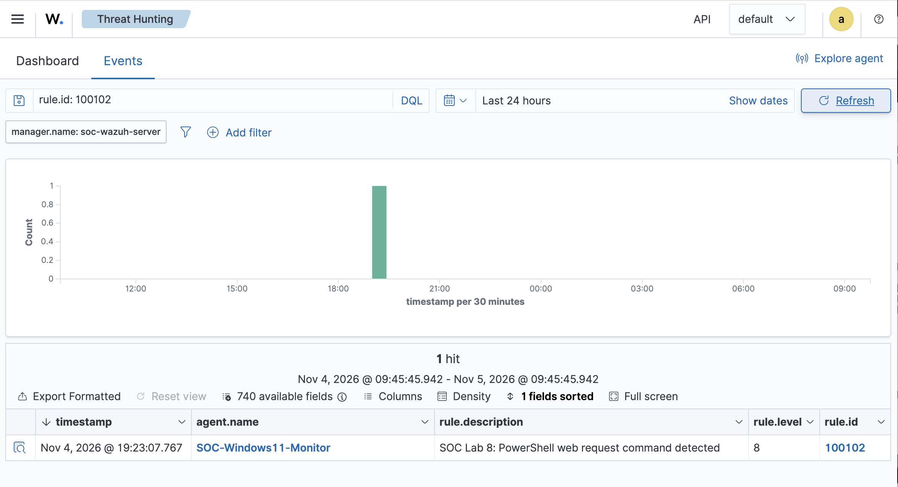

# SOC Investigation 07 — PowerShell Web Request Detection

## 1. Investigation Summary

| Field | Details |
|---|---|
| Investigation | Lab 8 — PowerShell Web Request |
| SIEM Platform | Wazuh 4.14.9 |
| Endpoint | Windows 11 |
| Monitoring | Wazuh Agent and Sysmon |
| Custom Rule ID | 100102 |
| Alert Severity | Level 8 |
| MITRE ATT&CK | T1105 — Ingress Tool Transfer |
| Classification | True Positive — Authorized Simulation |
| Status | Detection Validated |

## 2. Investigation Objective

Simulate a PowerShell-based web download and evaluate whether the SIEM generates an appropriate security alert.

Identify any gaps in existing detection coverage, develop a custom Wazuh rule, and validate its effectiveness using endpoint telemetry.

## 3. Simulated Activity

The following command was executed on the monitored Windows 11 endpoint:

```powershell
powershell.exe -NoProfile -Command "Invoke-WebRequest -Uri 'https://example.com/' -OutFile '$env:TEMP\SOC-Lab8-Test.html'"
```

The command uses PowerShell's `Invoke-WebRequest` to retrieve content from a benign public website and save it to a temporary HTML file.

This activity was performed as an authorized security simulation.

## 4. Initial Detection and Investigation

Sysmon Event ID 1 recorded the PowerShell process creation, including the executable path, command-line arguments, user context, and parent process.

The initial Wazuh investigation identified:

- Rule ID: `92027`
- Severity: Level 4
- Description: `Powershell process spawned powershell instance`

This alert identified the PowerShell parent-child process relationship but did not specifically identify the `Invoke-WebRequest` operation.

**Detection gap:** The observed alert did not provide a dedicated detection for the PowerShell web-request command.

## 5. Custom Detection Rule

A custom rule was added to `/var/ossec/etc/rules/local_rules.xml`:

```xml
<rule id="100102" level="8">
  <if_sid>61603</if_sid>
  <field name="win.eventdata.commandLine" type="pcre2">(?i)Invoke-WebRequest</field>
  <description>SOC Lab 8: PowerShell web request command detected</description>
  <mitre>
    <id>T1105</id>
  </mitre>
  <group>soc_lab,powershell,suspicious_download,</group>
</rule>
```

The rule inspects Sysmon process-creation telemetry and matches command lines containing `Invoke-WebRequest`, regardless of capitalization.

It does not establish whether the request was malicious or whether the transfer succeeded.

## 6. Detection Validation

The rule configuration was validated using:

```bash
sudo /var/ossec/bin/wazuh-analysisd -t
```

The Wazuh manager was restarted to apply the rule.

The PowerShell test command was executed again, and the Wazuh alert logs confirmed:

| Field | Observed Value |
|---|---|
| Alert timestamp (UTC) | 2026-11-05 00:23:07 |
| Rule ID | 100102 |
| Severity | 8 |
| Agent | SOC-Windows11-Monitor |
| Description | SOC Lab 8: PowerShell web request command detected |
| Command-line indicator | Invoke-WebRequest |

The Wazuh Threat Hunting dashboard displayed one matching alert.

**Result:** The custom rule successfully detected the simulated PowerShell web-request command.

## 7. Evidence



The screenshot confirms the alert's rule ID, severity, description, agent, and presence in the Wazuh dashboard.

## 8. MITRE ATT&CK Analysis

**T1105 — Ingress Tool Transfer**

Adversaries may transfer tools or files from external systems into compromised environments.

PowerShell web-request functionality can support such activity, making it useful for detection engineering and threat hunting.

However, the command is also used for legitimate administration. The technique mapping represents the simulated behavior, not evidence of a real intrusion.

## 9. SOC Analyst Assessment

**Classification:** True Positive — Benign / Authorized Simulation.

The custom rule correctly identified the intended command-line behavior.

There was no evidence in this investigation of malicious intent, unauthorized execution, or a compromised endpoint.

The available process-creation evidence confirms command execution but does not independently verify successful file transfer.

### Detection Limitations

- The rule detects the literal `Invoke-WebRequest` string and may miss alternative download methods or obfuscated commands.
- Legitimate administrative activity may produce similar alerts.
- Process-creation telemetry alone cannot establish download success or content safety.
- Additional network, PowerShell, and file telemetry would improve investigation confidence.

## 10. Conclusion

This investigation demonstrated an end-to-end SOC detection engineering workflow:

1. Execute an authorized simulation.
2. Review endpoint telemetry and existing SIEM alerts.
3. Identify a detection coverage gap.
4. Develop and validate a custom detection rule.
5. Reproduce the activity and verify the alert.
6. Document findings, evidence, and limitations.

**Final outcome:** Custom Wazuh Rule 100102 successfully detected the PowerShell web-request simulation at Level 8.
