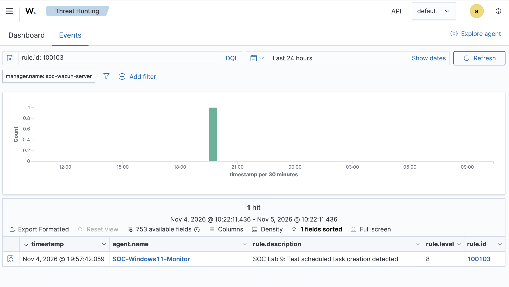

# SOC Investigation 08 — Windows Scheduled Task Persistence

## 1. Investigation Summary

| Field | Details |
|---|---|
| Investigation | Lab 9 — Scheduled Task Persistence |
| SIEM Platform | Wazuh 4.14.9 |
| Endpoint | Windows 11 |
| Log Source | Windows Security Event Log |
| Windows Event ID | 4698 |
| Built-in Wazuh Rule | 60228 — Level 4 |
| Custom Wazuh Rule | 100103 — Level 8 |
| MITRE ATT&CK | T1053.005 — Scheduled Task |
| Classification | True Positive — Authorized Simulation |
| Status | Detection Validated |

## 2. Investigation Objective

Simulate scheduled task creation as a Windows persistence technique, investigate the resulting security telemetry, and develop a custom Wazuh detection rule.

The objective was to demonstrate the ability to identify persistence-related activity, analyze Windows Security events, and improve SIEM detection coverage.

## 3. Lab Environment

- **SIEM:** Wazuh Manager and Dashboard
- **Monitored endpoint:** Windows 11 virtual machine
- **Agent:** SOC-Windows11-Monitor
- **Event collection:** Wazuh Windows Security event monitoring
- **Simulation:** Scheduled task configured to launch Notepad at user logon

All activity was performed within an authorized home-lab environment.

## 4. Simulated Activity

Windows scheduled task auditing was enabled using:

```powershell
auditpol /set /subcategory:"Other Object Access Events" /success:enable /failure:enable
```

The following command was executed in an elevated PowerShell session:

```powershell
schtasks /create /tn "SOC-Lab9-Test" /tr "notepad.exe" /sc onlogon /f
```

The command registered a scheduled task named `SOC-Lab9-Test` that launches `notepad.exe` when the configured user logs on.

The simulation used a legitimate Windows application and did not execute malicious software.

## 5. Windows Event Investigation

Windows generated Security Event ID **4698**, indicating that a scheduled task was created.

The event contained the following information:

| Field | Observed Value |
|---|---|
| Event ID | 4698 |
| Event Description | A scheduled task was created |
| Task Name | \SOC-Lab9-Test |
| Creator | WIN-1II1QICSGLT\Dhiraj |
| Executable | notepad.exe |
| Trigger | LogonTrigger |
| Run Level | LeastPrivilege |

The event also included the task definition in XML format, providing information about the configured trigger, action, and security context.

## 6. Initial Wazuh Detection

Wazuh successfully ingested the Windows Security event and generated an alert using its built-in detection rule:

| Field | Result |
|---|---|
| Rule ID | 60228 |
| Severity | Level 4 |
| Description | A scheduled task was created |
| MITRE ATT&CK | T1053 — Scheduled Task/Job |

The existing rule provided visibility into scheduled task creation but did not specifically identify the lab's task name.

This presented an opportunity to implement a more targeted detection.

## 7. Custom Detection Engineering

A custom rule was added to `/var/ossec/etc/rules/local_rules.xml`:

```xml
<rule id="100103" level="8">
  <if_sid>60228</if_sid>
  <field name="win.eventdata.taskName" type="pcre2">(?i)SOC-Lab9-Test$</field>
  <description>SOC Lab 9: Test scheduled task creation detected</description>
  <mitre>
    <id>T1053.005</id>
  </mitre>
  <group>soc_lab,scheduled_task,persistence,</group>
</rule>
```

The rule extends the existing scheduled-task creation detection and matches task names ending with `SOC-Lab9-Test`, ignoring capitalization.

The severity was configured as Level 8 for the purposes of the simulation.

**Detection scope:** This is a task-name-specific proof of concept, not a general-purpose detection of malicious scheduled tasks.

## 8. Validation and Testing

The Wazuh rule configuration was validated using:

```bash
sudo /var/ossec/bin/wazuh-analysisd -t
```

After successful validation, the Wazuh manager was restarted.

The first attempt to test the custom rule replaced an existing scheduled task, and no Rule 100103 alert was observed.

The test task was subsequently deleted and recreated to produce a fresh task-creation event.

The second test successfully generated the custom alert.

### Confirmed Alert

| Field | Observed Value |
|---|---|
| Timestamp (UTC) | 2026-11-05 00:57:42 |
| Rule ID | 100103 |
| Severity | Level 8 |
| Description | SOC Lab 9: Test scheduled task creation detected |
| Agent | SOC-Windows11-Monitor |
| Task | SOC-Lab9-Test |

**Result:** The custom rule successfully detected the authorized scheduled task creation.

## 9. Evidence



The screenshot shows the Wazuh Threat Hunting dashboard filtered to Rule 100103, including the Windows agent, alert description, severity, and rule identifier.

## 10. MITRE ATT&CK Mapping

**Technique:** T1053.005 — Scheduled Task

Windows scheduled tasks can be used by adversaries to execute programs automatically or maintain persistence.

In this simulation, a task was configured to launch Notepad at logon.

The technique mapping describes the mechanism being tested and does not imply that malicious persistence occurred.

## 11. SOC Analyst Assessment

**Classification:** True Positive — Benign / Authorized Simulation.

The detection correctly identified the intended task-creation activity.

The available evidence shows that:

- A scheduled task was created on the monitored endpoint.
- Windows recorded the activity through Security Event ID 4698.
- Wazuh generated a built-in Level 4 alert.
- The custom Level 8 rule successfully matched the test task.

There was no evidence of unauthorized persistence, malicious execution, or endpoint compromise.

### Detection Limitations

- The custom rule matches a specific task name and may miss tasks created under other names.
- Scheduled tasks are commonly used for legitimate system administration.
- Task creation alone does not prove malicious intent.
- Further investigation of the executable, task author, trigger, and surrounding activity is necessary for production alerts.
- The rule does not independently confirm that the configured task action executed.

## 12. Conclusion

This investigation demonstrated the following SOC capabilities:

1. Configuring Windows security auditing.
2. Investigating Windows Security Event ID 4698.
3. Analyzing scheduled task definitions and execution triggers.
4. Identifying existing Wazuh detection coverage.
5. Developing and validating a custom SIEM rule.
6. Troubleshooting detection behavior through repeated testing.
7. Documenting findings using MITRE ATT&CK.

**Final outcome:** Custom Wazuh Rule 100103 successfully detected the scheduled task creation simulation at Level 8.
